# Kubernetes Fundamentals Lab


Hands-on Kubernetes basics on a local [kind](https://kind.sigs.k8s.io/) cluster: Pods,
multi-container Pods, Deployments and scaling, ClusterIP and NodePort Services, and a
NetworkPolicy that blocks unwanted traffic. Every step is backed by a screenshot.

Built for the *Kubernetes and Securing Microservices* course in Sheridan College's
Cloud Security program (June 2025).

## At a glance

| Task | What I did | Result |
| --- | --- | --- |
| 1. Cluster | Created a kind cluster with NodePorts 30000–30002 mapped to my machine | Control plane `Ready`, all system pods running |
| 2. Pods | Ran a single nginx Pod and a 2-container Pod (nginx + busybox) | Both running; busybox logs every 30 s |
| 3. Deployments | Deployed nginx with 3 replicas, then scaled to 5 | 3 → 5 pods with one command |
| 4. Services | Exposed nginx inside the cluster (ClusterIP) and outside it (NodePort) | Reached from a busybox pod and from `localhost:30000` |
| 5. NetworkPolicy | Allowed only pods labelled `access=allowed` to reach nginx | Not enforced on old kind; enforced after upgrading kind (see below) |
| 6. Clean up | Deleted every resource and the cluster | Clean environment |

## How the pieces connect

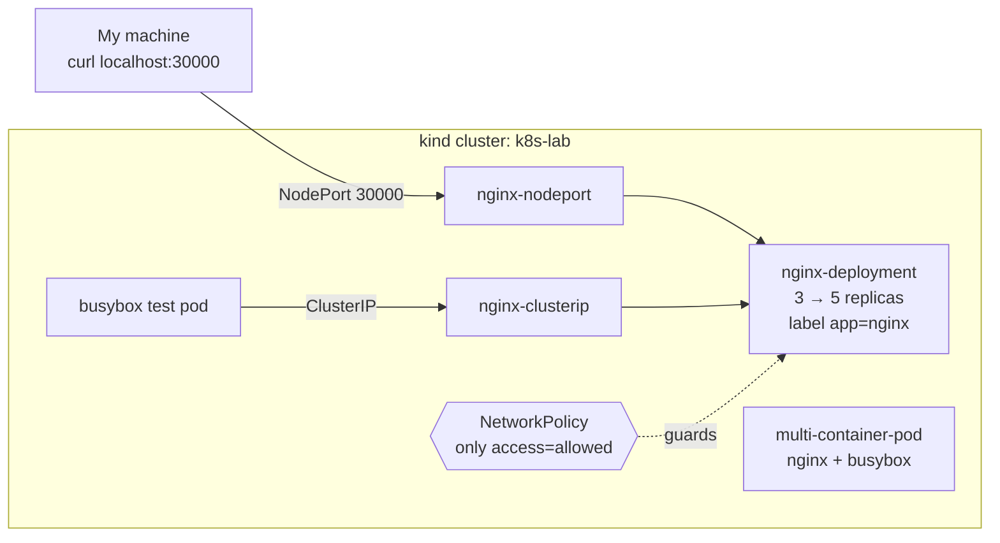

## Project structure

```
kubernetes-fundamentals-lab/
├── 01-cluster/kind-config.yaml
├── 02-pods/
│   ├── simple-pod.yaml
│   └── multi-container-pod.yaml
├── 03-deployments/nginx-deployment.yaml
├── 04-services/
│   ├── clusterip-service.yaml
│   └── nodeport-service.yaml
├── 05-network-policy/network-policy.yaml
└── screenshots/
```

## Task 1: Kind cluster

```bash
kind create cluster --name k8s-lab --config 01-cluster/kind-config.yaml
kubectl get nodes
kubectl get pods -n kube-system
```

The control-plane node came up `Ready`, and CoreDNS, etcd, the API server, scheduler,
controller manager, kube-proxy and the kindnet CNI were all running.

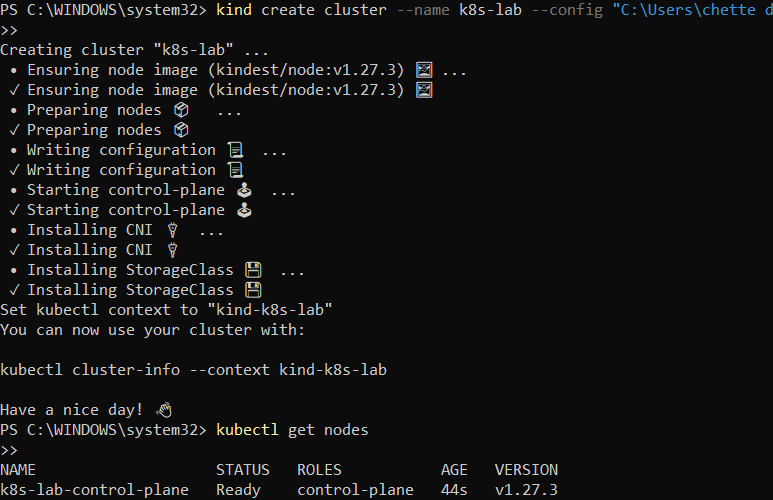
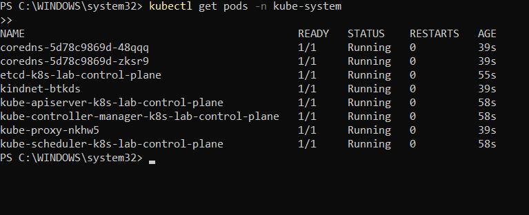

## Task 2: Pods

```bash
kubectl apply -f 02-pods/simple-pod.yaml
kubectl apply -f 02-pods/multi-container-pod.yaml
kubectl get pods
kubectl describe pod multi-container-pod
kubectl logs multi-container-pod -c busybox
```

- `nginx-pod` runs a single nginx container on port 80
- `multi-container-pod` runs nginx and busybox side by side, shown as `2/2` ready. The two containers share the pod's network and lifecycle.
- busybox prints `Hello from busybox` every 30 seconds

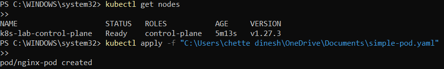
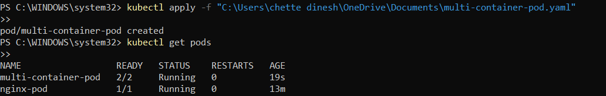
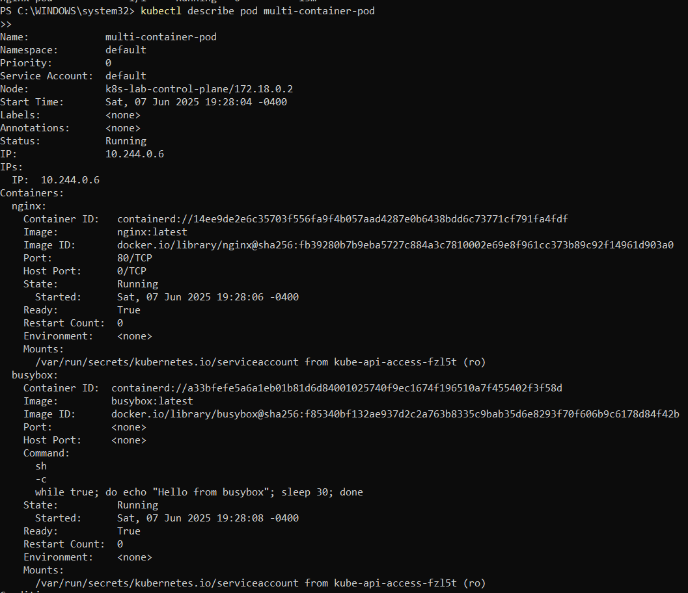
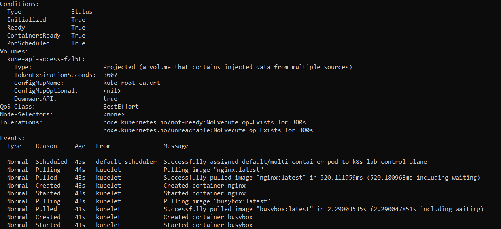
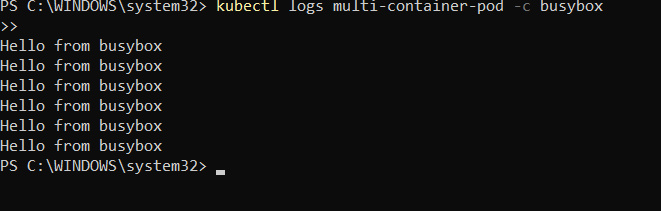

## Task 3: Deployments and scaling

```bash
kubectl apply -f 03-deployments/nginx-deployment.yaml
kubectl get deployments
kubectl scale deployment nginx-deployment --replicas=5
kubectl get pods
```

The Deployment created 3 nginx pods, and one `kubectl scale` command took it to 5. The
Deployment keeps that number running: if a pod dies, it starts a new one.

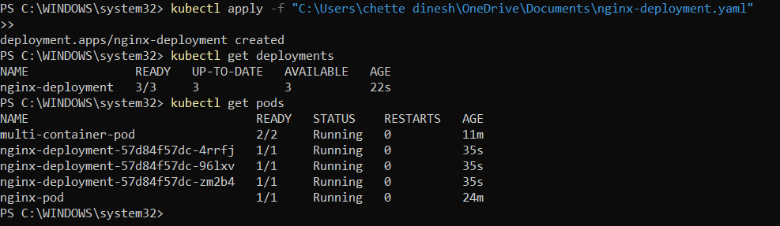
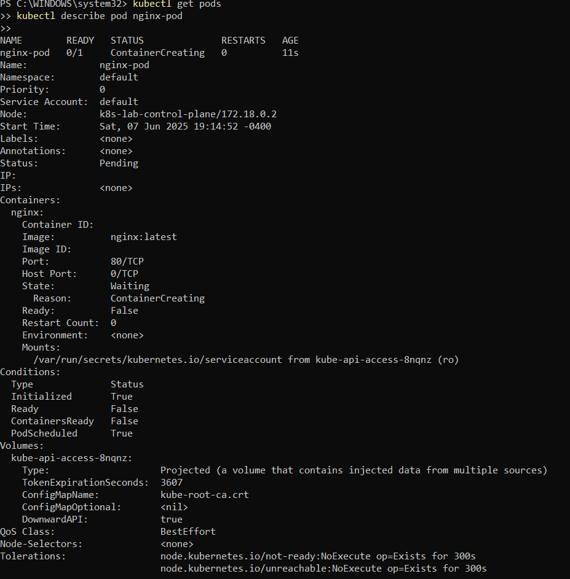
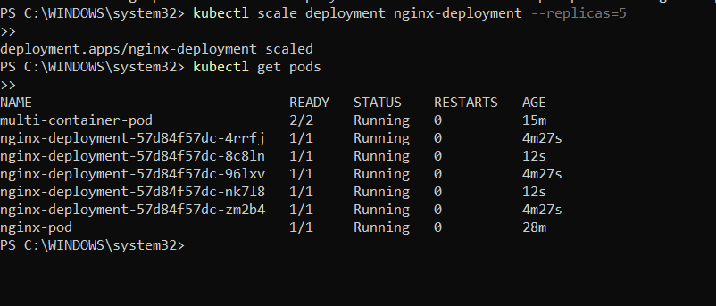

## Task 4: Services

```bash
kubectl apply -f 04-services/clusterip-service.yaml
kubectl apply -f 04-services/nodeport-service.yaml
kubectl get services

# inside the cluster
kubectl run test-pod --image=busybox -it --rm -- sh
wget -O- nginx-clusterip:80

# from my machine
curl http://localhost:30000
```

| Service | Type | Reached from | Result |
| --- | --- | --- | --- |
| `nginx-clusterip` | ClusterIP | busybox pod inside the cluster | nginx welcome page |
| `nginx-nodeport` | NodePort 30000 | my machine, `localhost:30000` | HTTP 200 OK |

Both services find the pods through the `app=nginx` label, and spread traffic across all 5 replicas.

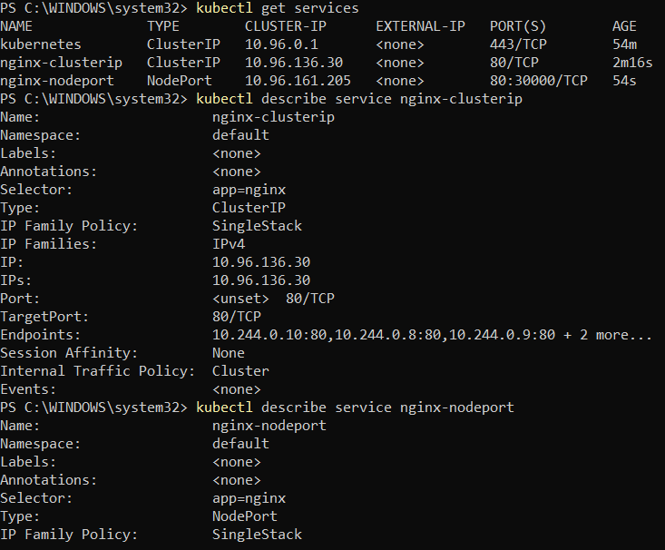

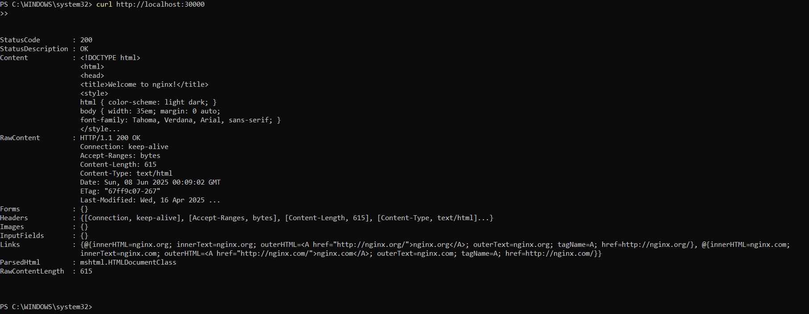

## Task 5: NetworkPolicy

The policy selects the nginx pods (`app=nginx`) and only lets in traffic on port 80 from
pods labelled `access=allowed`. Everything else should be blocked.

```bash
kubectl apply -f 05-network-policy/network-policy.yaml
kubectl get networkpolicy

# blocked: no label
kubectl run blocked-client --image=busybox --rm -it --restart=Never -- wget -T 5 -O- nginx-clusterip

# allowed: has the label
kubectl run allowed-client --image=busybox --labels="access=allowed" --rm -it --restart=Never -- wget -T 5 -O- nginx-clusterip
```

**First run (kind with Kubernetes v1.27.3):** the policy was created, but a test pod could still
reach nginx. That version of kind's default network plugin didn't enforce NetworkPolicies.

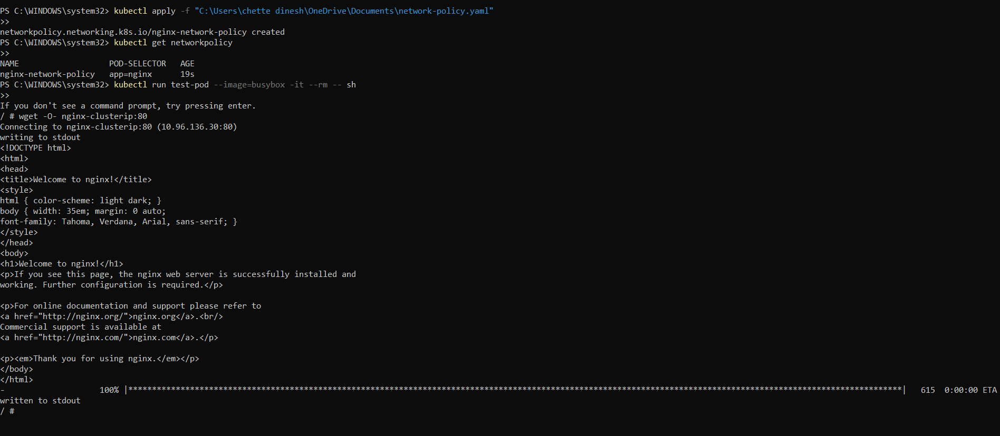
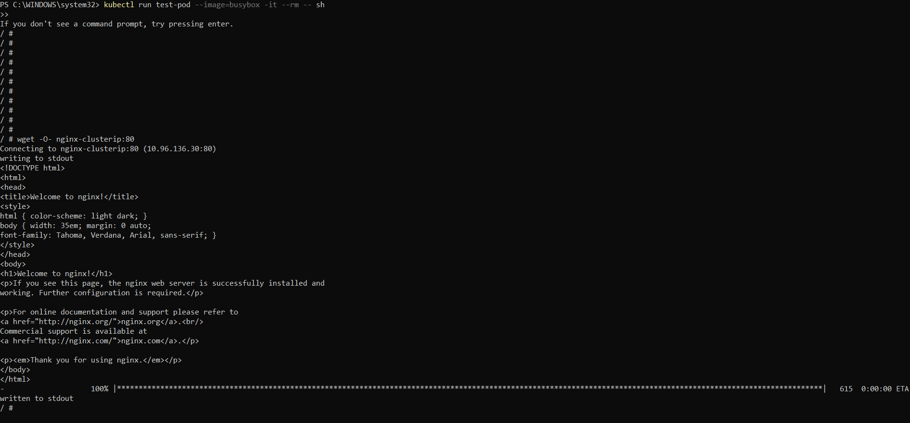

**Re-test after upgrading kind:** kind v0.24.0 and later enforce NetworkPolicies out of the box.
I upgraded kind, ran the lab again, and the policy worked: the unlabelled pod timed out
and the labelled pod got the nginx page.

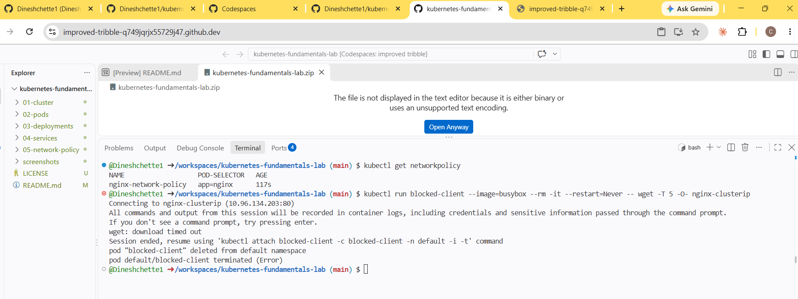
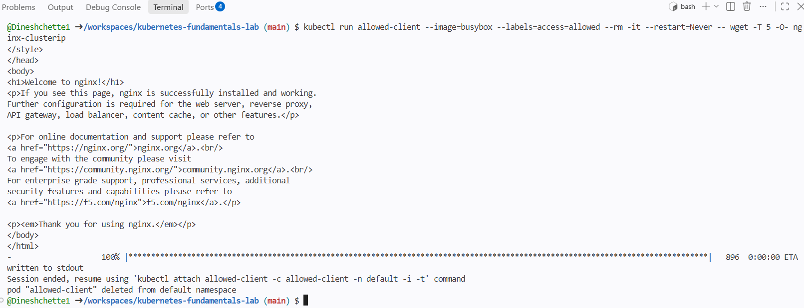

## Task 6: Clean up

```bash
kubectl delete -f 05-network-policy/ -f 04-services/ -f 03-deployments/ -f 02-pods/
kind delete cluster --name k8s-lab
```

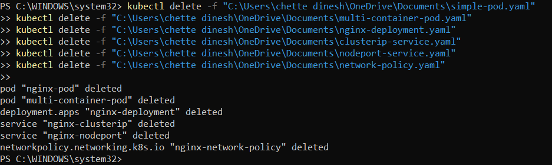
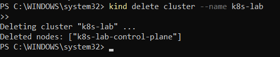

## What I learned

- **Pods** are the smallest unit Kubernetes runs; containers in one pod share network and lifecycle
- **Deployments** keep a set number of pods running and make scaling one command
- **Services** give pods a stable address: ClusterIP inside the cluster, NodePort from outside
- **Labels** connect everything: Deployments, Services and NetworkPolicies all find pods through them
- **NetworkPolicies** only work if the network plugin enforces them, so always test that a policy actually blocks traffic

## Problems I hit and fixed

| Problem | Fix |
| --- | --- |
| "File not found" errors when applying YAML | My file paths had spaces (`C:\Users\chette dinesh\...`); quoting the full path fixed it |
| NetworkPolicy created but traffic still got through | Old kind didn't enforce policies. Upgrading to kind v0.24+ fixed it; installing a CNI like Calico is the other option |

## Author

**Dinesh Chette** · Cloud & DevOps Engineer · [GitHub](https://github.com/Dineshchette1) · [LinkedIn](https://www.linkedin.com/in/dineshchette)
